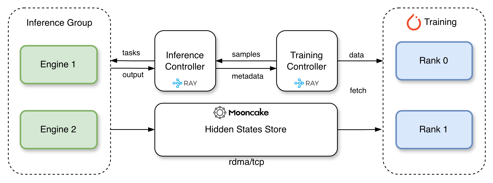

# TorchSpec

TorchSpec is a torch-native speculative decoding training framework. We introduce a disaggregated way of training speculative decoding draft models where inference and training are fully decoupled and stream hidden states directly from inference engine groups to distributed training workers via [Mooncake](https://github.com/kvcache-ai/Mooncake) store, allowing each side to scale independently.

## Adoption

TorchSpec has been adopted by production inference platforms and the vLLM ecosystem:

- [DigitalOcean](https://www.digitalocean.com/blog/how-we-built-fastest-deepseek-minimax-qwen-on-blackwell-ultra) used TorchSpec to train an EAGLE3 draft model for MiniMax-M2.5 on DigitalOcean Serverless Inference.
- [vLLM](https://vllm.ai/blog/2026-05-11-vllm-tops-artificial-analysis) used TorchSpec and vLLM to train the custom EAGLE3 draft model featured in its Artificial Analysis leaderboard work.
- [CoreWeave](https://www.coreweave.com/blog/kimi-k2-7-code-now-available-on-serverless-inference-with-leading-benchmark-price-performance) used TorchSpec to train a DFlash speculative decoding model for Kimi K2.7 Code and contributed D-PACE support upstream.
- [fal](https://blog.fal.ai/how-we-achieved-1000-tok-s-and-16x-throughput-with-dspark-for-ideogram-v4-prompt-expander/) used TorchSpec to train a DSpark speculative decoding model for its Ideogram V4 prompt expander, reporting 16x throughput gains with DSpark.
- [Tencent Hunyuan](https://x.com/TencentHunyuan/status/2082447023626944936) open-sourced [**AngelSpec**](https://arxiv.org/abs/2607.25852), adopting TorchSpec for training and featuring it in the paper.

## 🤗 Released Models

Draft models trained with TorchSpec, available on the [LightSeek Foundation](https://huggingface.co/lightseekorg) Hugging Face organization:

- [lightseekorg/kimi-k2.5-eagle3](https://huggingface.co/lightseekorg/kimi-k2.5-eagle3)
- [lightseekorg/kimi-k2.5-eagle3-mla](https://huggingface.co/lightseekorg/kimi-k2.5-eagle3-mla)
- [lightseekorg/kimi-k2.6-eagle3](https://huggingface.co/lightseekorg/kimi-k2.6-eagle3)
- [lightseekorg/kimi-k2.6-eagle3-mla](https://huggingface.co/lightseekorg/kimi-k2.6-eagle3-mla)
- [lightseekorg/kimi-k2.6-eagle3.1-mla](https://huggingface.co/lightseekorg/kimi-k2.6-eagle3.1-mla)
- [lightseekorg/kimi-k3-eagle3-mla](https://huggingface.co/lightseekorg/kimi-k3-eagle3-mla)
- [lightseekorg/kimi-k3-dflash2](https://huggingface.co/lightseekorg/kimi-k3-dflash2)
- [lightseekorg/kimi-k3-dspark](https://huggingface.co/lightseekorg/kimi-k3-dspark)

Draft models trained with TorchSpec, available from other organizations:

- [Inferact/MiniMax-M3-EAGLE3](https://huggingface.co/Inferact/MiniMax-M3-EAGLE3)
- [Inferact/Kimi-K3-DSpark](https://huggingface.co/Inferact/Kimi-K3-DSpark)

## 🚀 Blogs and Announcements

- 🔥 [TorchSpec: Speculative Decoding Training at Scale](https://www.youtube.com/watch?v=M7fbxwBSIeI) (Youtube Video, Ray Summit 2026)
- [Releasing Kimi K3 Draft Collection: Efficient Draft Training in TorchSpec](https://lightseek.org/blog/kimi-k3-draft-collection.html) (Sep 2026)
- [EAGLE 3.1: Advancing Speculative Decoding Through Collaboration Between the EAGLE Team, vLLM, and TorchSpec](https://lightseek.org/blog/eagle-3-1.html) (May 2026)
- [TorchSpec: Speculative Decoding Training at Scale](https://pytorch.org/blog/torchspec-speculative-decoding-training-at-scale/) (PyTorch Blog, March 2026)
- [TorchSpec: Speculative Decoding Training at Scale](https://lightseek.org/blog/torchspec-speculative-decoding-training-at-scale.html) (March 2026)

## Table of Contents

- [Architecture Overview](#architecture-overview)
- [Inference Backend Support](#inference-backend-support)
- [Quick Start](#quick-start)
- [Setup](#setup)
- [Examples](#examples)
- [Training Modes](#training-modes)
- [Checkpoint Conversion](#checkpoint-conversion)
- [Metrics Reporting](#metrics-reporting)
- [Troubleshooting](#troubleshooting)

## Architecture Overview

<p align="center">
  
</p>

TorchSpec is built around a disaggregated training pipeline:

- **Inference engines** generate target-model hidden states with inference engines.
- **Mooncake store** transfers tensors between inference and training without materializing them on disk.
- **Training workers** consume streamed hidden states to train speculative decoding draft models.

This separation keeps the training side focused on optimization while letting the inference side scale for hidden-state generation throughput.

## Inference Backend Support

TorchSpec streams hidden states from inference engines into training workers.

| Backend | Support Tier | Status |
|---------|--------------|--------|
| [vLLM](https://github.com/vllm-project/vllm) | First-class | Available |
| [TokenSpeed](https://github.com/lightseekorg/tokenspeed) | First-class | In progress |
| [TensorRT-LLM](https://github.com/NVIDIA/TensorRT-LLM) | First-class | Available |
| [SGLang](https://github.com/sgl-project/sglang) | Best community effort | Available |
| [HuggingFace Transformers](https://github.com/huggingface/transformers) | Best community effort | Available |

## Quick Start

Train an Eagle3 draft model for Qwen3-8B on a single node with 4 GPUs (2 for training and 2 for inference):

```bash
./examples/qwen3-8b-single-node/run.sh
```

Override config values directly from the CLI:

```bash
./examples/qwen3-8b-single-node/run.sh training.learning_rate=5e-5 training.num_train_steps=500
```

For the shared H800 three-node Qwen3.8-27B setup, start Ray and training together:

```bash
bash run.sh                   # DFlash2 (default)
bash run.sh dspark            # DSpark
bash run.sh --dry-run         # Preview without contacting SSH or Ray
```

This launcher reuses live Ray nodes and starts missing workers in parallel over SSH.
It uses the existing `h800conda.sh` environment and defaults to training on
`10.120.0.211`, with inference on `10.120.0.218` and `10.120.0.187`.
See the [three-node recipe](examples/qwen3.8-27b-dflash2-3node/README.md)
for SSH requirements, node overrides, and checkpoint resume options.

## Setup

### Quick Setup

```bash
# Install with vLLM
./tools/build_conda.sh 1 vllm
micromamba activate torchspec

# Or install with SGLang
./tools/build_conda.sh
micromamba activate torchspec

# Or install TokenSpeed from an editable source checkout
./tools/build_conda.sh 1 tokenspeed
micromamba activate torchspec
```

To install into your current environment instead:

```bash
./tools/build_conda.sh current tokenspeed  # or 'sglang', 'vllm', or 'both'
```

The TokenSpeed backend currently requires a Python 3.12 environment because
its native kernel dependency wheels do not support Python 3.14.

Optional: install Flash Attention support:

```bash
pip install -e ".[fa]"
```

### Backend-Specific Usage

**vLLM**

```bash
./examples/qwen3-8b-single-node/run.sh configs/vllm_qwen3_8b.yaml
```

**SGLang**

```bash
./examples/qwen3-8b-single-node/run.sh
```

**TensorRT-LLM**

Run inside the TensorRT-LLM image (`docker/trtllm/v1.3.0rc18/Dockerfile`), which ships `tensorrt_llm` pre-patched for Mooncake hidden-state capture:

```bash
./examples/qwen3-8b-single-node/run.sh configs/trtllm_qwen3_8b.yaml
```

Single-node tensor parallelism only for now (multi-node TP is not yet wired up).

TorchSpec uses vLLM's **Worker Extension** mechanism to hook into the model forward pass and capture hidden states directly inside worker processes, which avoids RPC serialization overhead during extraction. For SGLang, TorchSpec applies a patch to the existing codebase to enable hidden-state extraction. For TensorRT-LLM, TorchSpec builds on its native **SaveHiddenStates** speculative mode and applies a small patch that redirects the captured aux + final hidden states to Mooncake instead of writing them to disk.

### Updating the SGLang patch

Commit your changes in the `_sglang` checkout, then regenerate `patches/sglang/<version>/sglang.patch` from the pinned base commit with `./tools/update_sglang_patch.sh`.

## Examples

| Example | Backend | Model |
|---------|---------|-------|
| [hf-quickstart](examples/hf-quickstart/) | HuggingFace | Qwen3-8B |
| [qwen3-8b-single-node](examples/qwen3-8b-single-node/) | Inference engine | Qwen3-8B |
| [kimi-k25-2node-h200](examples/kimi-k25-2node-h200/) | Inference engine | Kimi-K2.5 |
| [kimi-k25-3node-h100](examples/kimi-k25-3node-h100/) | Inference engine | Kimi-K2.5 |
| [minimax-m25-5node-h200](examples/minimax-m25-5node-h200/) | Inference engine | MiniMax-M2.5 |

See [examples/README.md](examples/README.md) for more details about each example.

To reduce temporary memory during dataset preprocessing, set
`dataset.tokenization_batch_size=1000` on the command line or in YAML:

```yaml
dataset:
  tokenization_batch_size: 1000
```

The default `0` processes the whole source at once. A positive value limits the
raw conversations and intermediate results held per batch, while reusing the
tokenization workers. Sample order, filtering, output fields, and existing caches
are preserved. The final processed dataset still stays in memory; this option
does not bound its total size. It also applies to deferred prompt formatting;
already-tokenized inputs and cache hits use their existing loading paths.

## Training Modes

### Offline Replay Training

Offline replay ([Docs](docs/offline_training.md)) is a training mode that separates target-output generation from draft-model training by reading hidden states from disk. Recommended for testing and development on 1 GPU.


### Resume vs. Continual Training

Both modes use `training.load_path`, but they restore different states:

| Goal | `training.load_path` | `training.continual_training` | What gets restored |
|------|----------------------|-------------------------------|--------------------|
| Resume an interrupted run | Required | `false` (default) | Model, optimizer, LR scheduler, RNG, and step metadata |
| Start a new run from existing weights | Required | `true` | Model weights only |

Resume the same run:

```yaml
training:
  load_path: /path/to/old_run/checkpoints

output_dir: /path/to/old_run
```

Start a new run from existing weights:

```yaml
training:
  load_path: /path/to/old_run/checkpoints
  continual_training: true
  learning_rate: 1e-5
  warmup_ratio: 0.01
  num_epochs: 1

output_dir: /path/to/new_run
```

Start a new run from an existing Hugging Face checkpoint. `--input` accepts a Hugging Face Hub repo id (downloaded automatically), a local HF/safetensors directory or `.safetensors` file, or a TorchSpec DCP checkpoint dir:

```bash
python tools/convert_to_torchspec.py \
    --input org/dflash-checkpoint \
    --config torchspec/config/dspark_draft_config_qwen36_35b.json \
    --output ./outputs/dspark_init
```

Then warm-start from the generated init:

```yaml
training:
  load_path: ./outputs/dspark_init
  continual_training: true
```

Using this technique, you can also warm-start DSpark training runs from a pre-trained DFlash model for faster convergence.

## Checkpoint Conversion

Convert an FSDP checkpoint to HuggingFace format:

```bash
python tools/convert_to_hf.py --input-dir ./outputs/my_experiment/iter_0010000/
```

Vocabulary pruning, which reduces the draft model `lm_head` to a smaller token set and emits `d2t` and `t2d` mappings, can be applied either during training or at conversion time.

DFlash2 requires the full target vocabulary. Do not set `draft_vocab_size` or pass `--prune-vocab` for a DFlash2 model.

- **Pre-pruning**: set `draft_vocab_size` in your training config. The checkpoint already contains the pruned `lm_head` and `d2t`/`t2d` buffers, so the basic conversion command is enough.
- **Post-pruning**: train with the full vocabulary, then pass `--prune-vocab` at conversion time together with a representative dataset to compute token frequencies.

```bash
python tools/convert_to_hf.py \
    --input-dir ./outputs/my_experiment/iter_0010000/ \
    --prune-vocab \
    --dataset-path Aeala/ShareGPT_Vicuna_unfiltered \
    --draft-vocab-size 32000 \
    --tokenizer Qwen/Qwen3-8B \
    --chat-template qwen \
    --prompt-key conversations
```

Pass `--cache-dir ./cache` to reuse the tokenized dataset cache from training.

## Metrics Reporting

W&B logging is disabled by default with `logging.report_to: none`. To see draft
training loss curves in W&B, authenticate once in the training environment:

```bash
wandb login
```

Then set the following in your training YAML:

```yaml
logging:
  report_to: wandb
  wandb_project: torchspec
  wandb_mode: online
```

For a team project, also set `logging.wandb_team` to your W&B entity. For
non-interactive jobs, supply `WANDB_API_KEY` through the environment instead of
running `wandb login`.

You can also enable W&B for an existing config with CLI overrides:

```bash
python -m torchspec.train_entry --config configs/sglang_qwen3_8b.yaml \
  logging.report_to=wandb \
  logging.wandb_project=torchspec \
  logging.wandb_mode=online
```

Open the run URL printed by W&B and view `train/avg_loss` against `train/step`.
Loss is reported once per optimizer step after aggregation across training
ranks and gradient accumulation. `train/ploss_0`, `train/ploss_1`, etc. show
loss at each prediction position; when evaluation is configured,
`eval/avg_loss` uses `eval/step` as its horizontal axis.

Use `logging.wandb_mode=offline` to save logs locally without uploading. To
view those curves in W&B later, run `wandb sync /path/to/wandb/offline-run-*`.
Offline mode does not update the W&B dashboard during training.

## Troubleshooting

Set `TORCHSPEC_LOG_LEVEL=DEBUG` for more verbose logging when diagnosing issues:

```bash
TORCHSPEC_LOG_LEVEL=DEBUG ./examples/qwen3-8b-single-node/run.sh
```

### Mooncake SEGFAULT

Current Mooncake version has a bug with TCP-only hosts causing a SEGFAULT error. Set `MC_STORE_MEMCPY=0` until the [upstream issue](https://github.com/kvcache-ai/Mooncake/issues/1986) is fixed.

### RDMA failure

If you get the error `... libcudart symbols not found globally. Make sure PyTorch with CUDA is installed before using TileLang`, reinstall mooncake to match your system CUDA version, i.e. if you run on CUDA 13, mooncake is probably installed for cu12 wheels, re-install it using `uv pip uninstall mooncake-transfer-engine && uv pip install mooncake-transfer-engine-cuda13`.

### Per-Rank File Logging

Set `TORCHSPEC_LOG_DIR` to an absolute path on a shared filesystem (NFS) to enable per-rank log files for every Ray actor on both training and inference:

```bash
export TORCHSPEC_LOG_DIR=/my_project/running_logs
```

This creates a structured directory with one file per actor, organized by role and node:

```text
running_logs/
  training/
    10.0.0.1/
      training_g0_rank0_20260301_080012.log
      training_g0_rank1_20260301_080012.log
    10.0.0.2/
      training_g0_rank2_20260301_080013.log
  inference/
    10.0.0.1/
      inference_g0_rank0_20260301_080014.log
    10.0.0.2/
      inference_g0_rank1_20260301_080015.log
```

The path must be absolute and writable from all nodes. If `TORCHSPEC_LOG_DIR` is unset or not writable, per-rank file logging stays disabled and Ray falls back to stdout/stderr capture.

| Issue | Reference |
|-------|-----------|
| Stuck or failing distributed runs, Ray actor errors | [docs/debugging_ray_jobs.md](docs/debugging_ray_jobs.md) |
| Ray cluster setup, actor hierarchy, placement groups | [docs/ray.md](docs/ray.md) |
| Pipeline bottlenecks, slow steps, throughput analysis | [docs/performance_metrics.md](docs/performance_metrics.md) |
