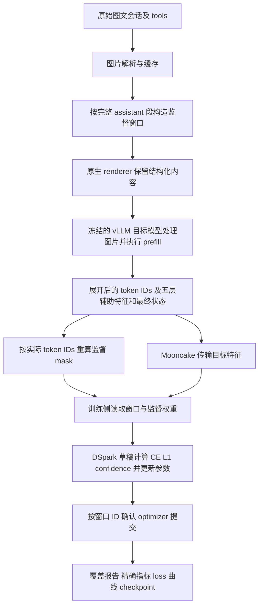

# 多模态 DSpark 训练实现与模块变更说明

这次实现把已有 DSpark 训练链路接到了原生图文会话上：目标模型读取图片和已有回答，产出含视觉上下文的隐藏状态；草稿模型学习已有 assistant 回答及目标分布。随后补齐长会话分窗、完整数据遍历、尾批处理和本地 loss 曲线，完成全部 327 条训练源会话的一轮训练。

核心代码新增 **5 个模块**，修改 **12 个已有模块**，另新增一个包含 7 个文件的单机图文示例目录。DSpark 模型结构、三项损失、FSDP 和 vLLM 视觉模型沿用已有实现；本次主要解决数据语义、视觉展开后的对齐和完整训练的可核验性。

本文以主仓库 `f0cce31` 为改动前基线，核对至 `9545d3e`，覆盖 2026 年 10 月 13 日至 14 日的图文 smoke、恢复验证及全量训练改动。目标 checkpoint 为 `sensenova-flash-lite-v42-20260830-dpo-mtp`，架构为 `Qwen3_5ForConditionalGeneration`；示例目录沿用 `qwen3.8-27b` 命名。术语使用根目录 [GLOSSARY.md](../GLOSSARY.md)，全部 assistant 监督的既有决定见 [ADR 0003](adr/0003-multimodal-dspark-all-assistant-supervision.md)。

## 训练数据如何流动



默认单机使用 8 张 GPU：4 张运行冻结的目标模型，TP=4；4 张运行草稿训练，FSDP `FULL_SHARD`。每卡 micro batch 为 1，累积 4 次，global batch 为 16。目标模型、视觉编码器、从目标加载的 embedding，以及目标 head/norm 保持冻结。

图片先进入目标模型的视觉编码器，再与文本 embedding 融合进入语言模型。DSpark 接收的是这些上下文产生的辅助隐藏状态；草稿侧沿用原有 token embedding 和训练结构。

## 新增的 5 个核心模块

| 新增文件 | 关键接口 | 解决的问题与具体行为 |
| --- | --- | --- |
| [qwen3_5_multimodal.py](../torchspec/data/renderers/qwen3_5_multimodal.py) | `Qwen35MultimodalRenderer` | 使用 checkpoint 原生模板，保留结构化图片、`tools`、`generation_config`、历史 reasoning 和 tool calls；固定 `preserve_thinking=true`、`add_generation_prompt=false`。生成 assistant 内容 mask，并显式清零视觉 token；超长输入报错。声明独立缓存版本和展开后重算 mask 的要求。 |
| [qwen3_5_full_data.py](../torchspec/data/renderers/qwen3_5_full_data.py) | `Qwen35FullDataRenderer` | 在图文 renderer 上支持窗口选中的 assistant 段。窗口内重叠的历史回答仅作上下文；校验 assistant 数量及选择序号。适配原生模板对中途 system 消息的限制，保留原角色和顺序；模板不匹配时直接报错。 |
| [supervision_windows.py](../torchspec/data/supervision_windows.py) | `prepare_full_data`、`_WindowBuilder` | 将全部源会话准备为有来源记录的监督窗口，按 processor 实际图片展开长度限制输入。缓存 HTTPS 图片并记录 SHA-256；记录窗口、源消息、被监督段和上下文缩短范围，产出 JSONL 与 manifest。 |
| [data_pass.py](../torchspec/controller/data_pass.py) | `CompleteDataPass` | 校验每个源 assistant 段恰好分配一次，跟踪窗口从入队到 optimizer 提交的完整生命周期。检查缺失、重复、失败、尾批 padding 及训练终点，提供 `coverage.json` 的数据。 |
| [dspark_metrics.py](../torchspec/utils/dspark_metrics.py) | `LocalDSparkMetrics`、`plot_loss_curve` | 按真实 optimizer metric step 写入精确分项 loss 和加权总 loss，持续生成四面板 `loss.png`；拒绝非有限值、重复或乱序 step，完成时核对 1 到最终步的完整指标序列。支持从 JSONL 重新绘图。 |

## 修改的 12 个已有模块

| 修改文件 | 原有职责 | 本次修改 |
| --- | --- | --- |
| [renderers/__init__.py](../torchspec/data/renderers/__init__.py) | renderer 注册 | 注册 `qwen3.5-multimodal` 和 `qwen3.5-full-data` 两个入口。 |
| [data/dataset.py](../torchspec/data/dataset.py) | 会话加载、分词与缓存 | 保留源 `metadata`，把 `supervision_window` 交给 renderer，再随样本传递。结构化内容、tools 的接入复用原有 renderer 接口。 |
| [config/train_config.py](../torchspec/config/train_config.py) | 配置定义与校验 | 新增 `num_proc`、`supervision_manifest_path`、`verify_parameter_updates`、`complete_data_pass`；把 manifest 纳入路径解析。全量模式要求单轮、vLLM prefill、指定 renderer 和 manifest，并拒绝 checkpoint 或草稿恢复。 |
| [inference/engine/vllm_engine.py](../torchspec/inference/engine/vllm_engine.py) | 目标模型请求与捕获结果适配 | 接收窗口元数据，按实际展开后的 `prompt_token_ids` 重算 packed mask；校验窗口 ID、展开长度和监督 token 数。额外返回生成的单 token 供 prefill 验收，训练序列仍只含 prompt。 |
| [controller/inference_manager.py](../torchspec/controller/inference_manager.py) | 异步推理调度 | 透传窗口元数据。全量模式下推理失败或无效捕获按窗口上报并终止，防止静默漏样本。 |
| [controller/training_controller.py](../torchspec/controller/training_controller.py) | 样本池与训练队列 | 接入 `CompleteDataPass`；校验加载数据和推理结果，禁止全量窗口重载。尾批创建零 loss dummy，成功 optimizer step 后登记真实窗口，原子写入覆盖报告。 |
| [controller/setup.py](../torchspec/controller/setup.py) | 自动计算训练步数 | 全量模式从向下取整改为 `ceil(窗口数/global_batch)`，拒绝与完整遍历终点冲突的训练步数和学习率步数。 |
| [controller/loop.py](../torchspec/controller/loop.py) | 训练主循环、指标与保存 | 训练 actor 成功返回后确认窗口提交；关闭全量模式的数据不足重载兜底，增加推理无进展超时。接入精确指标，排空延迟指标，使用同步 checkpoint 保存，并在成功或异常时写覆盖状态。 |
| [training/data_fetcher.py](../torchspec/training/data_fetcher.py) | 从 Mooncake 读取张量 | dummy 在本地创建零张量，无需读取 Mooncake。真实窗口读取失败或监督被原有容错机制清零时抛出带窗口 ID 的错误。 |
| [training/optimizer.py](../torchspec/training/optimizer.py) | BF16 参数与 FP32 master 参数优化 | 增加可选 `step(verify_update=True)`。检查参与更新的本地 FP32 参数，跨 rank 归约最大变化，要求有限且非零；记录实际使用的学习率及校验片段，支持恢复连续性核验。 |
| [training/trainer.py](../torchspec/training/trainer.py) | 训练 step 执行 | 通过 `verify_parameter_updates` 开关调用 optimizer 的更新验证接口。 |
| [transfer/mooncake/utils.py](../torchspec/transfer/mooncake/utils.py) | Mooncake master 启动 | 将固定等待 2 秒改为实际检查 master 与 metadata 服务可用性，最长等待 120 秒；服务退出或超时报错，修复服务未就绪时初始化模型的竞态。 |

依赖配置 [pyproject.toml](../pyproject.toml) 另增加 `full-data` 可选依赖组：`matplotlib`、`tensorboard`、`requests`、`pillow`，用于曲线、指标和图片准备。

## 新增的单机图文示例

新增目录为 [examples/qwen3.8-27b-image-text-1node](../examples/qwen3.8-27b-image-text-1node/README.md)，包含以下 7 个文件。

| 文件 | 用途 |
| --- | --- |
| [config.yaml](../examples/qwen3.8-27b-image-text-1node/config.yaml) | 三条源会话 smoke 的基础配置：启用视觉、原生 renderer、全部 assistant 监督、10 步训练和 11 步学习率周期。 |
| [prepare_data.py](../examples/qwen3.8-27b-image-text-1node/prepare_data.py) | 默认准备源行 114、217、231，覆盖多图及 tool 图片，派生 160 条独立 ID 的 smoke 记录；`--full-data` 转入全量窗口准备。 |
| [prefill.py](../examples/qwen3.8-27b-image-text-1node/prefill.py) | 真正运行图文 prefill，并从 Mooncake 取回特征，检查长度、有限值、监督和单 token 生成。以源消息、独立字符跨度及 tokenizer offsets 核验监督；另提供原文本回归。 |
| [prefill.sh](../examples/qwen3.8-27b-image-text-1node/prefill.sh) | 加载环境并启动 prefill 验证。 |
| [full_train.py](../examples/qwen3.8-27b-image-text-1node/full_train.py) | 校验数据与图片指纹，准备全量配置，选取 17 个不同窗口，依次执行图文预检、原文本回归、两步含尾批训练预检，再从零启动完整训练。 |
| [run.sh](../examples/qwen3.8-27b-image-text-1node/run.sh) | 统一启动入口；支持 smoke、smoke checkpoint 恢复、`--full-data`、`--dry-run`。全量模式拒绝恢复参数。 |
| [README.md](../examples/qwen3.8-27b-image-text-1node/README.md) | 使用方法、数据与监督语义、运行产物和验收范围。 |

## 关键实现约定

### 图片展开后重新对齐监督

原生模板先产生图片占位 token，vLLM processor 随后把它展开为实际视觉 token 序列。因此，展开前的 token 位置不能直接作为训练 mask。这里采用已注册 renderer，保持 `defer_tokenization=false`，随后在 vLLM 返回实际 prompt IDs 时重新计算监督。

`packed_loss_mask` 表示 mask 的交替 0/1 区段长度编码；一个监督窗口仍对应一条训练序列，未在这里加入跨会话拼接。

监督范围是所选 assistant 段中的正文、reasoning 和 tool-call 内容；system、user、tool 消息及视觉位置权重为零。assistant 角色头与 `<|im_end|>` 也不在内容 mask 内。prefill 为验证请求完成而新生成的 1 个 token 不进入训练序列。

CE、L1 和 confidence 沿用 DSpark 的同一套有效位置与衰减权重。对 anchor `a` 的第 `j` 个预测位置，标签来自 `input_ids[a+j+1]`，目标分布来自位置 `a+j` 的最终隐藏状态；预测块遇到不监督的位置后截断后续有效部分。这样图片展开、角色边界和目标状态的位移具有一致含义。

### 复用目标特征与 DSpark 模型

当前 checkpoint 的特征契约如下，`T` 表示图片展开后的 prompt 长度。

| 项目 | 值 |
| --- | --- |
| 目标辅助层，零基编号 | `[3, 15, 31, 47, 59]` |
| 对应采集槽 | `[4, 16, 32, 48, 60]` |
| 独立最终槽 | `64` |
| 拼接后的辅助张量 | `[T, 25600]`，即 5 × 5120 |
| 最终隐藏状态 | `[T, 5120]`，pre-norm |
| token IDs 与 mask | 均覆盖同一组 `T` 个 prompt 位置 |

训练侧沿用 [DFlashTrainer](../torchspec/training/dflash_trainer.py) 的冻结目标 norm，将最终 pre-norm 状态归一化后交给 [DSparkModel](../torchspec/models/dspark.py) 的目标分布计算。此处与 [Loop/mHC ADR](adr/0002-loop-mhc-dspark-capture-contract.md) 的独立 post-norm 最终状态契约不同。

本次提交范围内，[DSpark 草稿结构](../torchspec/models/draft/dspark.py)、[DSparkTrainer](../torchspec/training/dspark_trainer.py)、损失实现、anchor 抽样和 checkpoint 基础实现均为复用。主仓库的 vLLM gitlink 在基线与终点均为 `0cbe7e4`，本功能没有新增 vLLM 子模块源代码提交；图文 wrapper、视觉融合、辅助层捕获及 per-layer Mooncake 传输已有实现可用。

### 全量源会话转换为完整监督窗口

总请求上限为 131072 tokens，为生成的 1 个验证 token 预留位置，因此实际输入不超过 131071。`max_num_batched_tokens=8192` 是 vLLM 的分块预填充调度预算，不是会话截断长度。

分窗优先保留可容纳的完整 assistant 段。超长时先移除可省略的历史上下文，保留 system 消息和所需的最近 user 查询；仍放不下时，按比例缩短保留的 user/tool 文本前缀。每次省略消息或缩短文本都写入 `context_reductions`。被监督的 assistant 正文、reasoning 和 tool calls 保持完整，无法容纳时报告源行并失败。

每个原 assistant 段恰好分配给一个窗口作为监督；出现在其他窗口中的历史回答权重为零。图片随保留消息一起处理，顺序和占位符保持对应。HTTPS 图片下载到本地并记录内容指纹；GIF 沿用图像读取器的静态首帧、EXIF 方向及白底转换行为。中途 system 消息保持原角色和原相对顺序。

### 完整遍历以成功 optimizer 提交为准

`CompleteDataPass` 跟踪 `enqueued → submitted → received → dispatched → committed` 五个窗口集合。只有训练 actor 成功完成相应 optimizer step，窗口才计入 `committed`；进入推理队列或样本池本身不代表参与训练。

M 个真实窗口对应 `ceil(M/16)` 个 optimizer steps。尾批使用独立零 loss dummy 补齐分布式批次，这些 dummy 不增加源会话、监督段或真实窗口计数，也不贡献损失分子和分母。本次 M=610，训练 39 步，最后一步为 2 个真实窗口加 14 个 dummy。

全量模式只支持从零开始的一轮遍历。它禁止重复重载窗口，遇到推理失败、捕获丢失、监督失效或无进展超时时保留 `incomplete` 覆盖报告。smoke 模式另保留 10 步 checkpoint 恢复到第 11 步的验证入口。

### 全量运行的资源调整与指标口径

这些调整位于全量配置生成逻辑中，用于处理长度不同的长窗口和异步特征传输。

| 设置 | smoke 配置 | 全量配置及原因 |
| --- | --- | --- |
| renderer | `qwen3.5-multimodal` | `qwen3.5-full-data`，按窗口选择监督段 |
| 训练步数 / 学习率总步数 | `10 / 11` | 均由窗口数推导，本次 `39 / 39` |
| 推理 batch | 4 | 1，且 `max_num_seqs=1`，控制长窗口并发捕获显存 |
| 目标显存比例 | 0.8 | 0.7，为捕获 staging 留出空间 |
| 单请求图片上限 | 3 | 从 manifest 推导，本次为 20 |
| Mooncake 全局容量 | `64GB` | `256GB`，覆盖训练队列、待分发结果及在途捕获；已分发特征仍需保留到消费 |
| 训练 actor 分配器 | 原有配置 | 默认 `PYTORCH_CUDA_ALLOC_CONF=expandable_segments:True`，缓解变长窗口的显存碎片 |
| 指标输出 | 默认关闭，可覆盖 | 本地 TensorBoard、`metrics.jsonl`、`loss.png` |

两种模式均使用 `language_model_only=false`、`train_with_decode=false` 和 `VLLM_USE_V2_MODEL_RUNNER=0`。全量示例把模型、数据、布局和监督关键参数作为固定约定校验。

精确指标记录的加权总损失为 `0.1 × CE + 0.9 × L1 + 1.0 × confidence`，权重来自实际运行配置。原 `train/avg_loss` 保留既有 CE 汇总口径；新增曲线分别绘制加权总损失和三个分项，避免把 CE 日志当作优化总目标。

## 测试与实际验收结果

新增 [test_image_text_full_data.py](../tests/test_image_text_full_data.py) 和 [test_full_data_pass.py](../tests/test_full_data_pass.py)，覆盖图片准备、完整监督段分配、独立监督预期、窗口记账、尾批、失败报告、指标和启动配置。扩展的五个测试文件分别覆盖 [renderer](../tests/test_renderer_registry.py)、[vLLM 引擎](../tests/test_vllm_engine.py)、[取数](../tests/test_data_fetcher.py)、[optimizer](../tests/test_optimizer.py) 和 [Mooncake 就绪检查](../tests/test_mooncake_master.py)。

以下为已有 GPU 运行和测试记录，并非此次文档整理重新执行的训练。

| 验收范围 | 已完成结果 | 证据 |
| --- | --- | --- |
| 10 月 13 日图文 smoke | 源行 114、217、231 的完整图文 prefill 通过；展开长度分别为 11296、18792、77523，各生成 1 token；10 步训练后恢复完成第 11 步，草稿参数继续更新 | [smoke 验收记录](qwen3_8_27b_multimodal_results.md) |
| 原文本兼容 | 原文本配置和 loader 完成真实 GPU prefill；100 个输入 tokens，39 个监督 tokens，mask 与原路径一致 | [文本验收记录](qwen3_8_27b_multimodal_results.md) |
| 全量 GPU 预检 | 17 个不同图文窗口通过特征与独立监督核验；两步训练覆盖尾步 1 个真实窗口加 15 个 dummy | [预检产物](../outputs/image-text-full-20261014/preflight/) |
| 10 月 14 日完整训练 | 327 条源会话、610 个窗口、28872 个 assistant 段、39 个 optimizer steps；无缺失或重复，五个阶段的窗口 ID 集合一致 | [覆盖报告](../outputs/image-text-full-20261014/coverage.json)、[独立验收报告](../outputs/image-text-full-20261014/independent_acceptance.json) |
| 指标与模型保存 | step 1–39 指标完整、有限，分项与 TensorBoard 一致；加权总 loss 从约 3.69811 到 2.73908；保存 `iter_0000039`，model、optimizer、scheduler 各 4 个分片 | [精确指标](../outputs/image-text-full-20261014/metrics.jsonl)、[曲线](../outputs/image-text-full-20261014/loss.png)、[checkpoint](../outputs/image-text-full-20261014/checkpoints/iter_0000039/) |

全量实现阶段记录了 253 项聚焦回归通过；独立监督预期修订后，22 项 workflow 测试通过。后续捕获保留和 CUDA 分配器修复分别通过 23 项聚焦回归。全仓 suite 的阶段性结果为 1101 passed、24 skipped、74 failed、125 passing subtests，74 个失败用例 ID 与记录的基线相同；该运行早于后续资源修复，因此不能写成最终全仓测试通过。完整时间线及原始日志位置见 [全量训练规格与执行记录](../.scratch/qwen3_8_27b_image_text_full_train/spec.md)。旧 smoke 验收文档末尾的范围限制仅描述 10 月 13 日那次运行。

这次全量验收证明全部源会话及其监督段经过窗口分配并参与一次完整遍历。DSpark 仍采用原有 anchor 抽样，不保证每个目标 token 都在单轮被抽中；上述 loss 变化也不代表已经验证草稿的推理接受率、解码加速或回答质量。当前示例覆盖图文及 GIF 静态首帧，配置中 video 上限为 0。

## 入口与提交定位

先检查全量启动命令：

```bash
bash examples/qwen3.8-27b-image-text-1node/run.sh --full-data --dry-run
```

需要启动新的完整训练时，使用独立输出目录：

```bash
OUTPUT_DIR="$PWD/outputs/image-text-full-new" \
  bash examples/qwen3.8-27b-image-text-1node/run.sh --full-data
```

仅准备数据、仅执行预检、smoke 恢复和曲线重绘命令见 [示例 README](../examples/qwen3.8-27b-image-text-1node/README.md)。

| 提交 | 对应改动 |
| --- | --- |
| `0274360`、`f9ddb89` | 原生图文监督、prefill、smoke 训练与恢复验证 |
| `d6d8131` | 全量分窗、覆盖记账、尾批、本地指标与曲线 |
| `f0a01f1` | 用独立源消息跨度核验 GPU 监督 |
| `04ca980` | 等待 Mooncake 服务实际就绪 |
| `59cf513` | 为长窗口捕获预留目标显存 |
| `e6fd5bf` | 扩充 Mooncake 容量，保留已排队但未消费的捕获 |
| `b5681e8` | 训练侧可扩展 CUDA 分配，处理变长窗口显存碎片 |
| `9545d3e` | 记录完整 GPU 遍历验收结果 |
